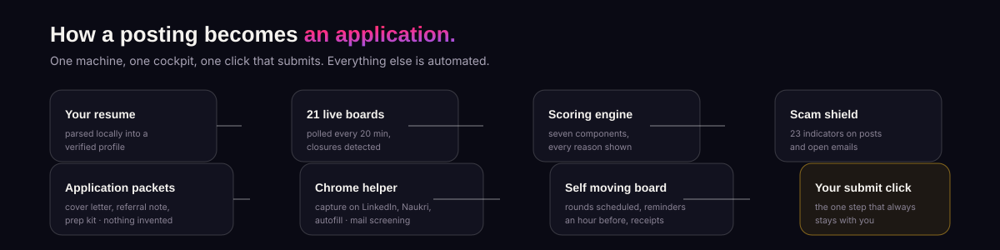
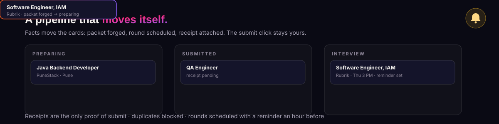

# JobForge

<p align="center">
  
</p>

<p align="center">
  <a href="https://github.com/siddhant-pardeshi/JobForge/stargazers"></a>
  <a href="LICENSE"></a>
  
  
  <a href="docs/media/jobforge-video-tour.mp4"></a>
  <a href="docs/media/jobforge-walkthrough.wav"></a>
  <a href="docs/media/JobForge-Guide.pdf"></a>
</p>

<p align="center">
  <a href="https://readme-typing-svg.demolab.com"></a>
</p>

JobForge is a job hunt cockpit for software engineers in India. Point it at your resume, and it pulls live openings from 21 employer career boards (Zscaler Pune, Databricks, Meesho, Rubrik, Okta, Stripe, GitLab, Figma, MongoDB, OpenAI and more), scores each one against your actual skills, flags scam mails before you reply, drafts your cover letter and referral note, and keeps the whole pipeline on a board that updates itself.

It runs on your machine. Your resume and keys never leave it. There is no demo data anywhere: the first refresh pulls ~5,800 genuine postings.

```bash
git clone https://github.com/siddhant-pardeshi/JobForge.git
cd JobForge
npm install
npm run dev
```

Open http://localhost:5173, drop in your resume, done. Prefer the single process version? `npm run build && npm start` and use http://localhost:8787. New here? Read **[the 16 page Field Guide PDF](docs/media/JobForge-Guide.pdf)** or watch **[the animated video tour](docs/media/jobforge-video-tour.mp4)**.

## How a posting becomes an application

<p align="center"></p>

One machine, one cockpit, one click that submits. Your resume is parsed locally into a verified profile. Twenty one boards are polled on a schedule, every posting scored by seven transparent components and screened by twenty three fraud indicators. Packets, prep kits and referral messages are drafted from your resume. The Chrome helper captures postings while you browse and prefills application forms. The tracker organizes itself. And the one step that always stays human is the submit click.

---

## Every feature, in detail

### 1. The resume engine

<p align="center"></p>

Upload a PDF, DOCX or pasted text and JobForge parses it entirely on your machine into an editable structured profile: contact details, headline, skills with evidence, projects, education, certifications. Every extracted fact carries a confidence chip (high, medium, low) so you know exactly what to double check, and everything is editable before it counts.

The parser is tuned for Indian tech resumes and their failure modes. Space eating PDF fonts are handled by camel case reconstruction, so `SpringBoot` still maps to Spring Boot and `RESTAPIs` to REST APIs. A seventy technology synonym taxonomy means Java 17 counts as Core Java while JavaScript never gets mistaken for Java. Scanned PDFs are detected and reported honestly instead of guessed at. Skills drive thirty points of every match score, making this the single highest leverage edit in the app: add a skill the boards keep asking for and watch roles jump lanes the moment you save.

### 2. Live boards and honest refresh

<p align="center"></p>

Discovery runs on documented public listing endpoints, not scraping. The registry ships with 21 employers verified against their live endpoints before shipping: Zscaler with its real Pune engineering center, Databricks, Meesho, Rubrik, Okta, Pure Storage, Cloudflare, Elastic, Stripe, GitLab, Figma, MongoDB, Coursera, Yugabyte, Spotify, OpenAI, Cursor, Supabase, PostHog, Linear and Perplexity. The first refresh pulls ~5,800 genuine postings.

A background scheduler polls every board every 20 minutes (configurable). New postings appear without you asking. Closure detection is deliberately careful: a posting that vanishes gets one grace miss, because boards transiently drop listings, and is marked closed only after two consecutive misses, with a timestamp. Reposts reopen automatically and duplicate detection merges cross source copies while preserving every source URL. You can add any Greenhouse, Lever or Ashby company by pasting its careers URL: the provider and board handle are detected, and the board is probed live before saving. The coverage dashboard always distinguishes "zero matching jobs" from "this source could not be checked".

### 3. The scoring engine

<p align="center"></p>

Every posting gets a 0 to 100 score from seven weighted components: demonstrated skill fit (30), responsibility and project fit (20), experience fit (15), location fit (15), compensation fit (10), employer evidence (5) and freshness (5). The classification reads the actual work described, not the company name, so a sales role at a software company is excluded while an engineering role at a bank matches. Ambiguous titles go to a review lane instead of being guessed.

Unknowns stay neutral: an unlisted salary never buries a great Pune role and never triggers a confident relocation recommendation. International pay bands stay in their native currency, so no exchange rate is ever invented. Lanes keep the board honest: Best in Pune, Remote from Pune, Relocation, Needs verification, and a Filtered out lane where every exclusion shows its reason. Weights are sliders in Settings and the whole board re-ranks live as you drag them.

### 4. Fraud screening, three ways

<p align="center"></p>

Recruitment fraud in India starts with a fee demand and ends with a drained account, so JobForge hunts it aggressively. Paste any WhatsApp forward or job ad into the screen. Switch to full email mode for sender, reply-to, subject and body analysis with link inspection. Or pair the Chrome helper and press one button inside Gmail or Outlook: the open email is screened in place and a color coded verdict panel appears with per flag advice.

Twenty three indicators cover fee demands, UPI and OTP traps, guaranteed placement hooks, reply-to addresses that divert from the sender, free mailbox recruiters, sender domains that do not match the claimed employer, link text that lies about its destination, shorteners, urgent-plus-money combinations and more. Calibration matters: a WhatsApp contact alone is never declared fraudulent, but a payment demand blocks automated action no matter how perfect the role looks. Every verdict shows its evidence, and the log stays private on your machine.

### 5. Packets, referral messages and the prep kit

<p align="center"></p>

Press Forge application packet and ten seconds later you hold a tailored cover letter built from your resume against that specific description, plus a referral message of about 100 characters mentioning a real project and the role title, ready to send to anyone at the company. Both copy in one click, both grounded strictly in resume facts, and both sharp either way: deterministic drafting works with no AI key, and a provider key only improves the wording.

Every packet also carries an interview prep kit: five to eight questions the interviewer for this role would plausibly ask, grounded in required skills your resume supports, your flagship project, behavioral signals in the description and honest gap answers. The questions list covers everything the resume cannot answer, like expected pay, so nothing is invented on your behalf. Your original resume file is never modified; packets are separate documents.

### 6. The tracker that organizes itself

<p align="center"></p>

Applications move through a real state machine, and the kanban moves cards on facts: forging a packet slides a role into Preparing, scheduling an interview round slides it into Interview, and attaching a confirmation receipt finally makes a submission count. Duplicates are blocked automatically, and the board re-renders every five seconds with spring animations.

Rounds carry a name, date, time and mode. Each one joins the Today radar with a live countdown and fires a browser notification an hour before, once per round. The funnel and outcome history show what is actually working for you, and the whole board runs while the app is open.

### 7. Relocation economics

Considering an offer outside Pune? The calculator separates fixed pay from variable, deposits from rent, and joining bonuses from monthly cash, then produces cautious, base and favorable scenarios with the honest monthly surplus, savings margin and the gap over staying in Pune. Policy checks answer yes or no against your own thresholds. Undisclosed pay returns "affordability unknown" plus the exact questions to ask the recruiter, never a guess. Numbers are planning aids, not tax advice.

### 8. The Chrome helper

The extension in `extension/` pairs with your cockpit in two minutes and works on LinkedIn, Naukri, Greenhouse, Lever, Ashby, SmartRecruiters, Workday, plus Gmail and Outlook:

* **Send to JobForge** captures the posting you are viewing, scored and scam screened within a second. Duplicates are detected and skipped.
* **Autofill with JobForge** fills application forms from your saved data. It remembers every value, you can edit any of them in the extension or in the app, and a correction never repeats.
* **Check this email** screens the open mail inline with a color coded verdict panel.

It never presses submit. Not anywhere. LinkedIn and Naukri ban automated activity and the ban lands on your account, so the helper stops one click short and leaves that click to you. That is also why JobForge itself never scrapes those platforms: boards with public APIs get polled, everything else gets captured when you browse it. Full setup walk through: [docs/EXTENSION_GUIDE.md](docs/EXTENSION_GUIDE.md).

### 9. AI keys, optional

Everything above works with no key at all. Add one and the cover letters and bullets get sharper:

| Provider | Where to get the key | Cost | Why pick it |
| --- | --- | --- | --- |
| Groq | console.groq.com/keys | Free tier | Fastest start, generous limits, the recommended first key |
| Anthropic Claude | console.anthropic.com/settings/keys | Pay per use | Best cover letter writing. Haiku is cheap, Sonnet is finest |
| OpenAI | platform.openai.com/api-keys | Pay per use | Solid all rounder, gpt-4o-mini is inexpensive |
| Ollama | ollama.com/download | Free, local | Fully offline, resume never leaves the machine |
| OpenRouter | openrouter.ai/keys | Free daily models | One key, hundreds of models to experiment with |
| Z.ai GLM | z.ai/manage-apikey/apikey-list | Pay per use | GLM models through an OpenAI compatible endpoint |

Settings, add key, press Test. Keys sit in a git ignored local file and travel only to the provider you chose.

### 10. Hosting it for others

Public mode turns your instance into a shared deployment: `npm start` with `"publicMode": true`, then `cloudflared tunnel --url http://localhost:8787`, then share the URL. By default it opens with **free access for everyone**. Guests get the full hunt as read only: live boards, scored matches, skill gap and pay insights, scam screening and relocation math. Everything that mutates your data or config is owner only, enforced server side.

Settings, Access holds the switch: flip to private and visitors need a six digit code, flip back and the link is open to all. Only you can flip it, using the host machine or the admin code printed at startup, and the access code, admin code, pairing token and resume text are never sent to guests.

### 11. What it deliberately does not do

* No CAPTCHA solving, no rate limit evasion, no hidden automation
* No unattended submission on any platform, no scraping of LinkedIn or Naukri
* No guaranteed interview percentages or magic ATS scores
* Your data never trains anything and never gets sold

## Project layout

```
server/     Express API, scoring, board refresh, fraud engine, access control
client/     React 19, Vite, Tailwind 4, Framer Motion
extension/  Chrome MV3 helper
test/       38 tests, npm test
docs/       guides, video tour, walkthrough audio, capability matrix
tools/      video and audio generation scripts
```

38 tests cover the guarantees that matter: sales roles at software companies stay excluded, engineering roles at banks get matched, Pune beats equal relocation offers, fee demands block automation, closed detection needs two misses, duplicates merge with provenance, and the salary parser handles Indian and international formats.

Pull requests welcome, see [CONTRIBUTING.md](CONTRIBUTING.md). Found it useful? A star helps more engineers find it.

## License

MIT. Built in Pune by [Siddhant Pardeshi](https://github.com/siddhant-pardeshi).

<p align="center">
  
</p>
